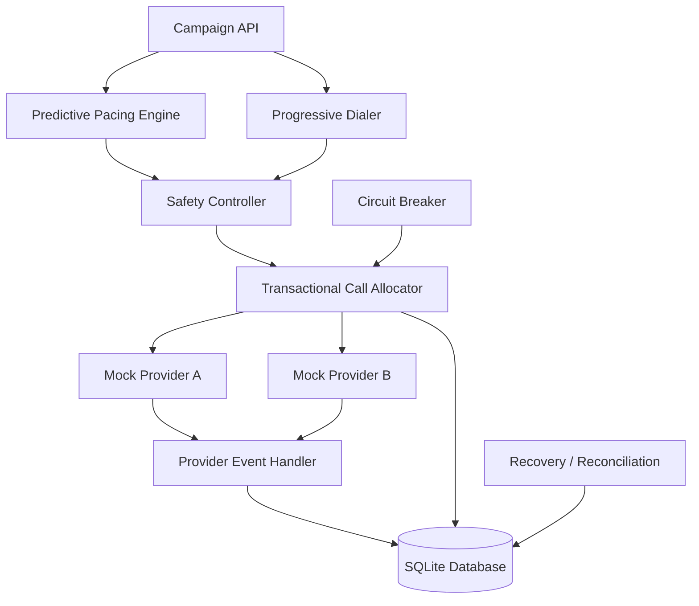

# CredResolve SmartDialer Architecture



## Design decisions

- FastAPI provides the API and interactive documentation.
- SQLite provides persistent local storage without a separate database server.
- The Progressive Dialer reserves one available agent and one queued borrower.
- Predictive pacing estimates demand but does not directly initiate calls.
- The Safety Controller limits new call requests.
- Mock providers simulate different reliability characteristics.
- Provider events are deduplicated using unique event IDs.
- The circuit breaker stops new requests after repeated provider failures.

## Production considerations

SQLite is intended for this local prototype. A multi-worker production deployment
should use a shared transactional database such as PostgreSQL, appropriate locking,
provider-side idempotency, durable event processing, and coordinated provider-health
state.

Provider timeouts can have ambiguous outcomes. Uncertain calls must be reconciled
before resources are released or calls are retried.
```
